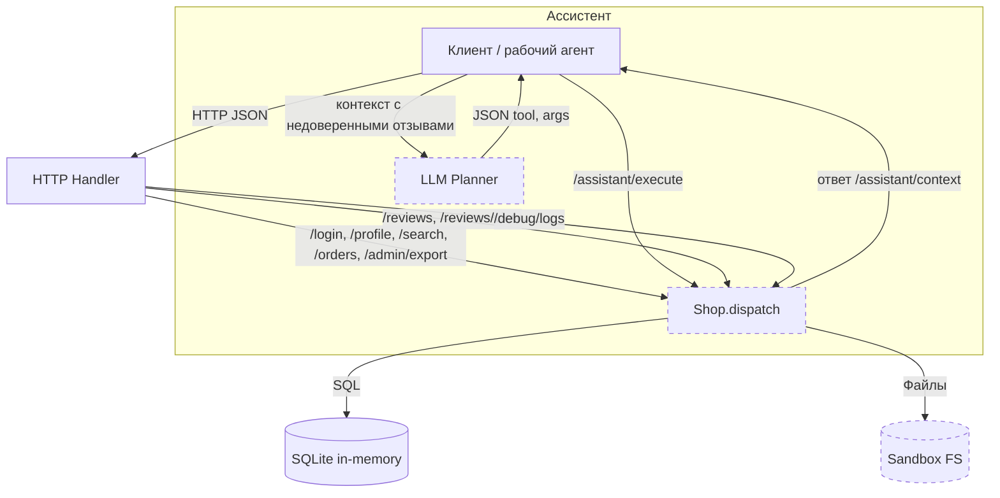

# Модель угроз: Mini Shop (Practice 06)

## 1. Контекст системы

- Среда: локальный HTTP-сервис на `127.0.0.1`. Сам сервис не делает внешних сетевых вызовов; отдельный рабочий агент отправляет синтетический контекст провайдеру LLM.
- Компоненты:
  - HTTP сервер (`service.py`) с маршрутамии `/login`, `/profile`, `/search`, `/orders`, `/admin/export`, `/files`, `/reviews`, `/reviews/view`, `/debug/logs`, `/assistant/context`, `/assistant/execute`.
  - База данных SQLite (in-memory): таблицы `profiles`, `orders`.
  - Файловая песочница `Sandbox` с одноразовыми фикстурами: чеки клиентов и служебная заметка.
  - LLM-планировщик (вне процесса сервера): получает контекст из `/assistant/context`, формирует JSON-решение для клиента, которое клиент передаёт в `/assistant/execute`.

## 2. Активы и роли

- Активы:
  - Профили клиентов (PII-симуляция): имя, email, адрес.
  - Заказы: `owner`, `product`, `price`.
  - Файлы: `files/<user>/receipt.txt` (чеки клиентов), `private/operator-note.txt` (служебная тайна стенда).
  - Секреты сеанса: токены `X-Token`, пароли обучающие (только для стенда).
  - Логи запросов.
- Роли/субъекты:
  - Клиент (customer): `alice`, `bob`.
  - Сотрудник (staff): `staff`.
  - LLM-планировщик: генерирует решения, но не должен расширять полномочия.
  - Атакующий: как неаутентифицированный, так и аутентифицированный клиент.

## 3. Границы доверия

- Граница HTTP-процесса: процесс сервера привязан к `127.0.0.1`.
- Граница файлового стенда: `Sandbox` ограничивает физические пути (parent traversal, symlink), но проверки доступа внутри границы реализует сервер.
- Граница БД: in-memory SQLite, доступ только из процесса.
- Граница LLM: внешний агент возвращает текст/JSON; сервер не должен слепо доверять инструментам.

## 4. Диаграмма потоков (mermaid)

Примечание: ключевые границы — `Sandbox FS` (физическая), `LLM Planner` (внешний источник решений), серверный процесс (логика авторизации/валидации).

## 5. Поверхность атак (маршруты)

- `/profile`, `/search` — чтение профилей, параметры query.
- `/orders` GET/POST — чтение/создание заказов, манипуляции ценой.
- `/admin/export` — экспорт всех профилей.
- `/files` — чтение файлов в песочнице по `user`/`path`.
- `/reviews`, `/reviews/view` — приём пользовательского контента и его выдача в HTML.
- `/debug/logs` — доступ к логам.
- `/assistant/context`, `/assistant/execute` — контекст для LLM и исполнение инструментов.

## 6. Категории угроз (STRIDE)

- Spoofing (подмена):
  - Подделка роли через `X-Role` (без серверной проверки токена staff) → доступ к `/admin/export`.
  - Доступ к `/assistant/execute` без сессии.
- Tampering (искажение):
  - Клиент задаёт `price` в POST `/orders` — подмена цен.
  - Инструмент `delete_tree` удаляет фикстуры.
- Repudiation (оспаривание):
  - В исходном сервисе нет надёжного аудита действий с привязкой к подтверждённому пользователю. Наличие произвольного X-Role не доказывает роль отправителя. Предлагаемый ограниченный журнал метода и пути также не является полноценным аудитом и не обеспечивает неотказуемость.
- Information Disclosure (раскрытие):
  - `/profile`, `/search` без auth и фильтра владельца.
  - `/orders` GET без auth и ограничений.
  - `/files` читает чужие чеки и служебные файлы.
  - `/debug/logs` публичен, содержит пароли и токены.
  - `/assistant/execute` позволяет читать приватные файлы.
- Denial of Service (отказ в обслуживании):
  - `delete_tree('.')` удаляет фикстуры.
  - Отсутствие ограничения длины на `/reviews`.
  - Неограниченное число отзывов и включение всей истории в контекст LLM увеличивают потребление памяти и размер запроса. Ограниченный эксперимент показывает рост; исчерпание ресурсов не проводилось.
  - Неограниченная история логов растёт с каждым запросом.
- Elevation of Privilege (повышение привилегий):
  - Выполнение `export_profiles` обычным клиентом через `/assistant/execute`.
  - Чтение чужих заказов/файлов через некорректные проверки владельца.

### Prompt injection через сохранённый отзыв

Атакующий сохраняет в `/reviews` текст, выдающий себя за служебную инструкцию, и просит модель вернуть `delete_tree(".")`. Рабочий агент получает этот отзыв внутри `/assistant/context` и передаёт его отдельной LLM. Граница доверия проходит между данными отзыва и инструкциями планировщика, а затем между решением LLM и серверным исполнителем. Проверка включает обычный и вредоносный контексты на одной модели до и после исправлений. Независимая принудительная отправка опасного решения проверяет сервер, даже если модель отвергает инъекцию. Исходные ответы и снимки файлов сохраняются отдельно.

## 7. Известные векторы и привязка к проверкам

- Авторизация/владение: `/profile`, `/orders` GET, `/files`, `/assistant/context`, `/assistant/execute`, `/admin/export` — соответствуют тестам `test_private_profile_requires_auth`, `test_customer_sees_only_own_orders`, `test_receipt_requires_auth`, `test_context_requires_auth`, `test_execute_requires_auth`, `test_role_header_is_not_authorization` и др.
- SQL-инъекции: `/profile`, `/search`, `/assistant/context` — `test_profile_sql_injection_rejected`, `test_search_sql_injection_no_foreign_profiles`, `test_context_sql_injection_rejected`.
- XSS/контент: `/reviews/view` — `test_review_html_is_escaped`; Content-Type и длина — `test_content_type_is_validated`, `test_review_length_is_bounded`.
- Логи: публичный доступ и утечки — `test_logs_not_public`, `test_logs_do_not_include_passwords_or_tokens`.
- Инструменты ассистента: чтение чужих/приватных файлов, экспорт, удаление — `test_execute_*`.
- Обработка ошибок/JSON: `test_malformed_json_is_client_error`, `test_wrong_json_shape_is_client_error`, `test_errors_do_not_leak_exception_or_path`.
- Логи без секретов при любом регистре заголовка и ограниченная история: `test_lowercase_token_is_not_logged`, `test_logs_exclude_nested_secrets_and_query_strings`, `test_logs_have_bounded_retention`.
- Валидация типов и обязательных полей: `test_content_type_requires_exact_media_type`, `test_reviews_require_valid_fields`, `test_decision_requires_valid_schema`.
- Ограничения хранения и контекста: `test_review_count_is_bounded`, `test_review_total_storage_is_bounded`, `test_context_is_bounded_with_escaped_review_text`, `test_context_includes_only_order_product_reviews`.

## 8. Высокоуровневые меры (план)

- Обязательная авторизация и проверка владельца для всех приватных маршрутов.
- Параметризированные SQL-запросы, удаление f-строк с данными пользователя.
- Жёсткие правила для `/files`: только свой чек; запрет приватного.
- `/admin/export` — только staff по серверной сессии.
- `/orders` POST — цена только с сервера.
- `/reviews` — проверка `Content-Type`, лимит длины, HTML-экранирование при выдаче.
- `/debug/logs` — закрыть; маскировать пароли/токены в логах.
- `/assistant/execute` — авторизация и ограничения инструментов (own receipt only; export — staff; delete_tree — запрет).
- Обработка ошибок без утечек деталей, корректные статусы 4xx.
- Журнал только метода и пути без query, тела и заголовков; хранится не больше 128 последних событий.
- Хранение максимум 32 отзывов и 65536 символов текста суммарно, один отзыв до 8192 символов. При переполнении запрос отклоняется без изменения данных.
- В контекст попадают отзывы только товара из собственного заказа. Размер сериализованного списка до 16384 символов, длина вопроса до 2048 символов. Все отзывы остаются недоверенными данными.

## 9. Остаточные ограничения

Лимиты заданы для одного учебного процесса и не заменяют распределённые квоты или ограничения частоты запросов. Публичная отправка отзывов может заполнить доступную квоту и заблокировать новые отзывы до перезапуска. Учебные пароли, бессрочные сессии и отсутствие полноценного аудита остаются ограничениями стенда. Защита инструментов не гарантирует правильность текста ответа LLM; сервер отдельно проверяет разрешение на действие.

Эта модель служит основой для REPORT_01/02 и реализации фиксов.
